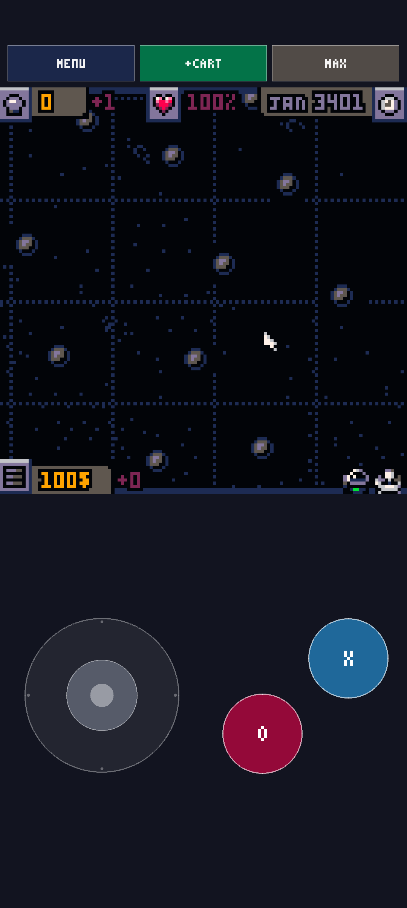
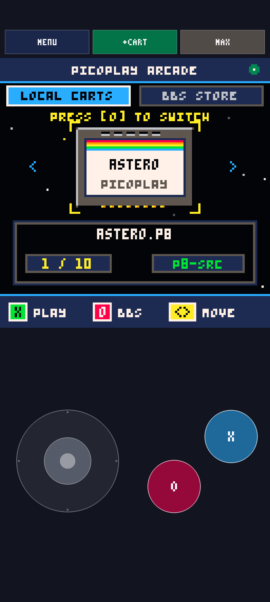
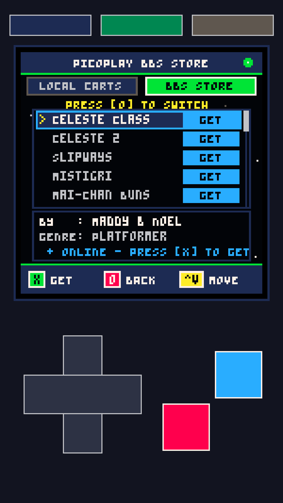
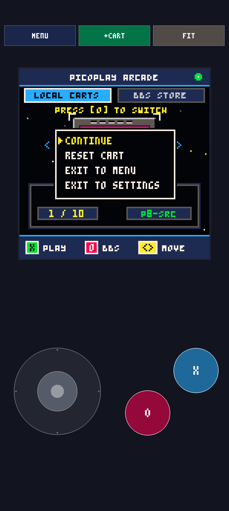

# PicoPlay Android — 8-Bit Fantasy Console Player & Pocket Arcade

<div align="center">

[](https://birth1mark.github.io/picoplay-android/)
[](https://birth1mark.itch.io/picoplay)
[](https://github.com/birth1mark/picoplay-android/releases/latest)
[](https://github.com/birth1mark/picoplay-android)
[](https://developer.android.com/guide/practices/page-sizes)
[](https://github.com/birth1mark/picoplay-android)
[](https://github.com/birth1mark/picoplay-android/blob/main/LICENSE.MD)

<br/>

**PicoPlay Android** is a high-performance, native C++ player and arcade frontend for 128×128 8-bit fantasy console cartridges (PICO-8 ecosystem). Engineered specifically for modern Android smartphones, tablets, Android TV, and dedicated gaming handhelds (Retroid Pocket, AYN Odin, Anbernic).

Featuring an ergonomic **Pocket Touch Gamepad**, automatic Bluetooth/USB controller detection, an in-app **BBS Store** cartridge browser, mouse-driven touch emulation (for games like *Slipways*), and full **Android 15 (16KB page size)** alignment.

[**🌐 Live Website & Showcase**](https://birth1mark.github.io/picoplay-android/) • [**👾 Get on itch.io**](https://birth1mark.itch.io/picoplay) • [**⬇️ Download APK (v1.0.1)**](https://github.com/birth1mark/picoplay-android/releases/latest/download/picoplay-full-v1.0.1.apk) • [**🎮 PS4 Edition**](https://github.com/birth1mark/picoplay-ps4)

</div>

---

## 📸 Screenshots Showcase

<p align="center">
  
  
  
  
</p>

---

## ⚡ Key Features

- **🕹️ Ergonomic Pocket Touch Gamepad**:
  - Permanently anchored virtual thumbstick with 8-way directional tracking and cardinal axis gating (thumb never accidentally drifts off-screen).
  - Tactile circular `[O]` (Red) and `[X]` (Blue) action buttons ergonomically angled for natural thumb resting.
- **🎮 Seamless Physical Controller Auto-Detection**:
  - Connect any Bluetooth or USB controller (PS4 DualShock 4, PS5 DualSense, Xbox Wireless, 8BitDo, Retroid Pocket, Odin).
  - On-screen touch overlay automatically hides upon detecting physical controller inputs, leaving a pristine, unobstructed view. Touching the screen restores the overlay instantly.
- **🖱️ Full Mouse & Touch Cursor Support**:
  - Direct touch-to-mouse translation allows point-and-click fantasy console masterpieces (like *Slipways*, *Dungeonmans*, or *Lemmings*) to be played with pure intuitive touch taps and drags.
- **📺 3 Smart Display Scaling Modes**:
  - **MAX**: Full 1080px edge-to-edge presentation maximizing smartphone viewport area.
  - **FIT**: Authentic framed retro handheld bezel with proportional margins.
  - **1:1**: Pixel-perfect integer scaling for ultra-sharp CRT-like retro authenticity.
- **🌐 In-App BBS Arcade Store**:
  - Search, explore, and download trending community cartridges directly inside the app with instant one-tap retrieval.
- **📁 Instant Cartridge Importer (`[+CART]`)**:
  - Native Android Storage Access Framework (SAF) integration: tap `[+CART]` to load any `.p8` (text cartridge) or `.p8.png` (cartridge image) directly from Downloads, Google Drive, or SD card.
- **🚀 Ultra-Optimized Native C++ Core**:
  - Powered by Fake-08 with SDL2 hardware-accelerated rendering and low-latency OpenSL ES audio. Runs at a locked 60 FPS with zero lag or battery drain.
- **🛡️ Android 15 & 16KB Page Aligned**:
  - Fully compliant with Google Play's strict 16KB memory page size alignment requirements and Target SDK 35 (Android 15).

---

## 📦 Downloads & Releases

| Edition | Package Name | Target Audience | Direct Download |
| :--- | :--- | :--- | :--- |
| **itch.io Edition** | `com.birth1mark.picoplay.full` | Community Gamers, Retro Handhelds | [**👾 Get on itch.io**](https://birth1mark.itch.io/picoplay) |
| **PicoPlay Full** *(Direct)* | `com.birth1mark.picoplay.full` | Smartphones, Tablets, Retroid Pocket, Odin, Handhelds | [**⬇️ Download Full APK (v1.0.1)**](https://github.com/birth1mark/picoplay-android/releases/latest/download/picoplay-full-v1.0.1.apk) |
| **PicoPlay Play Store** | `com.birth1mark.picoplay` | Google Play Store distribution (`.aab` / `.apk`) | [**⬇️ Download PlayStore APK**](https://github.com/birth1mark/picoplay-android/releases/latest/download/picoplay-playstore-v1.0.1.apk) • [**📦 Bundle (.aab)**](https://github.com/birth1mark/picoplay-android/releases/latest/download/picoplay-playstore-v1.0.1.aab) |

> 💡 *Looking for older versions or complete changelogs? Browse all [GitHub Releases](https://github.com/birth1mark/picoplay-android/releases).*

### Installation Instructions
1. Download `picoplay-full-v1.0.1.apk` on your Android device.
2. Open the file via your browser or Files manager (allow *"Install unknown apps"* if prompted).
3. Launch **PicoPlay** and start enjoying your favorite 8-bit cartridges!

---

## 🎯 Edition Comparison

| Feature | PicoPlay Full (Direct APK) | PicoPlay Play Store (Google Play) |
| :--- | :---: | :---: |
| **60 FPS Fantasy Console Emulation** | ✅ Full | ✅ Full |
| **Pocket Touch Gamepad (Stick + O/X)** | ✅ Full | ✅ Full |
| **External Bluetooth / USB Controllers** | ✅ Full | ✅ Full |
| **Local File Import (`.p8` / `.p8.png`)** | ✅ Full | ✅ Full |
| **Touch / Mouse Point-and-Click Emulation** | ✅ Full | ✅ Full |
| **In-App BBS Arcade Store & Downloader** | ✅ Included | ⏳ Clean SAF Importer (Policy Compliant) |
| **Target SDK 35 & 16KB Page Alignment** | ✅ Verified | ✅ Verified |
| **Google Play Safe (Zero Copyright Assets)** | Sideload Edition | ⏳ In Preparation for Play Store Review |

> **Note on Play Store Edition:** The Play Store flavor is specifically architected to adhere strictly to Google Play Developer policies, featuring open-source standalone starter carts and pure Storage Access Framework (SAF) loading. Full details and Google Play publication are scheduled for subsequent milestones.

---

## 🎮 Controls & Button Mapping

### On-Screen Pocket Touch Gamepad
- **Virtual Thumbstick (Bottom Left)**: 8-way directional tracking.
- **`[O]` Button (Red, Bottom Right)**: Primary Action / Jump / Confirm (`Z` / `C` / PICO-8 Button 4).
- **`[X]` Button (Blue, Bottom Right)**: Secondary Action / Dash / Cancel (`X` / `V` / PICO-8 Button 5).
- **`[MENU]` (Top Left)**: In-Game Pause / Reset Cartridge / Exit to Arcade Menu.
- **`[+CART]` (Top Center)**: Open Android File Picker to load `.p8` or `.p8.png` cartridges.
- **`[SCALE]` (Top Right)**: Cycle viewport scale (`MAX` ➔ `FIT` ➔ `1:1`).

### Physical Controller Mapping
| Controller Button | DualShock 4 / DualSense | Xbox Controller | PICO-8 Function |
| :--- | :--- | :--- | :--- |
| **D-Pad / Left Stick** | D-Pad / Left Analog | D-Pad / Left Analog | Directional Up/Down/Left/Right |
| **Primary Button** | ✖️ Cross | 🅰️ A Button | Action 1 / Jump (`O` / Button 4) |
| **Secondary Button** | ⭕ Circle | 🅱️ B Button | Action 2 / Dash (`X` / Button 5) |
| **Pause Button** | Options / Start | Menu / Start | Pause Menu (`START` / Button 6) |
| **Auto-Hide** | Any physical press | Any physical press | Automatically hides on-screen overlay |

---

## 🛠️ Building from Source

### Prerequisites
- Android SDK with API 35 (Android 15)
- Android NDK `27.1.12297006` or newer (supporting 16KB page size alignment)
- JDK 17
- CMake 3.22+

### Compilation
```bash
# Clone the repository
git clone https://github.com/birth1mark/picoplay-android.git
cd picoplay-android

# Build all release artifacts (APKs and Play Store Bundle)
cd android
./gradlew assembleFullRelease assemblePlaystoreRelease bundlePlaystoreRelease
```

### Run C++ Doctest Unit Tests
```bash
cd test
make -j$(nproc)
./testrunner.a
# All 48 test suites and 1,034 assertions will run and report status
```

### Desktop Chassis Preview Harness
```bash
# Run local interactive SDL2 desktop window (supports mouse & gamepad testing)
tools/preview/preview_chassis --interactive
```

---

## ⚖️ Legal & Trademark Notice

- **PicoPlay** is an independent, open-source project based on Fake-08 and SDL2.
- PicoPlay is **not affiliated with, endorsed by, or sponsored by Lexaloffle Games LLP**.
- *"PICO-8"* is a registered trademark of Lexaloffle Games LLP.
- All game cartridges, artwork, and trademarks displayed belong to their respective creators and copyright owners.

---

<div align="center">
  Crafted with ❤️ for the retro gaming community by <a href="https://github.com/birth1mark">birth1mark</a>.
</div>
